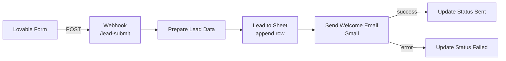
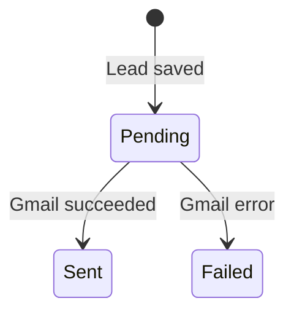

# AI HUB – Lead Management Automation


An end-to-end lead management system for **AI HUB**. When a visitor submits the website form, the lead is captured automatically, stored in Google Sheets, sent a personalized welcome email, and the delivery result (`Sent` / `Failed`) is written back to the same row.

**Live website:** https://clever-flow-consulting.lovable.app

---

## Table of Contents

1. [Features](#features)
2. [Architecture](#architecture)
3. [Workflow Nodes](#workflow-nodes)
4. [Webhook Payload](#webhook-payload)
5. [Google Sheet Structure](#google-sheet-structure)
6. [Email Status Lifecycle](#email-status-lifecycle)
7. [Demo](#demo)
8. [Setup Guide](#setup-guide)
9. [Testing](#testing)
10. [Security Notes](#security-notes)
11. [Repository Structure](#repository-structure)
12. [Author](#author)

---

## Features

- Lead capture form built with Lovable
- Webhook-based lead intake in n8n (no manual data entry)
- Auto-generated unique `leadId` and submission timestamp
- Every lead stored as a new row in Google Sheets
- Personalized welcome email sent via Gmail (uses the lead's name, service, company and message)
- Email delivery tracking: `Pending` → `Sent` or `Failed`, with a `emailSentAt` timestamp on success
- Error handling: if the email node fails, the workflow continues on its error output and marks the lead as `Failed` instead of stopping silently

---

## Architecture



---

## Workflow Nodes

| # | Node | Type | Purpose |
|---|------|------|---------|
| 1 | Lead Management Automation | Webhook (POST, path `lead-submit`) | Receives the form submission |
| 2 | Prepare Lead Data | Set | Generates `leadId` and `submissionDate`, maps form fields, sets `emailStatus = Pending` |
| 3 | Lead to Sheet | Google Sheets (append) | Saves the lead as a new row |
| 4 | Send Welcome Email | Gmail | Sends a personalized HTML email to the lead; routes errors to the error output |
| 5 | Update Status Sent | Google Sheets (update) | Matches by `leadId`, sets `emailStatus = Sent` and `emailSentAt` |
| 6 | Update Status Failed | Google Sheets (update) | Matches by `leadId`, sets `emailStatus = Failed` |

---

## Webhook Payload

The form sends a JSON body with these fields:

```json
{
  "name": "Jane Doe",
  "email": "jane@example.com",
  "company": "Example Ltd",
  "service": "AI Automation",
  "message": "I would like to automate my lead follow-up."
}
```

The values above are sample data for illustration only.

---

## Google Sheet Structure

| Column | Description |
|--------|-------------|
| `leadId` | Unique ID in the format `LEAD-<timestamp>` |
| `submissionDate` | Submission time (`yyyy-MM-dd HH:mm:ss`) |
| `name` | Lead's name |
| `email` | Lead's email address |
| `company` | Lead's company |
| `service` | Service the lead is interested in |
| `message` | Lead's message |
| `emailStatus` | `Pending`, `Sent` or `Failed` |
| `emailSentAt` | Time the email was sent (empty until sent) |

---

## Email Status Lifecycle



---

## Demo

### Screenshots

> TO BE CONFIRMED: replace the file names below with the actual files in the `images/` folder.

| Lead data in Google Sheets | Email status in Google Sheets |
|---|---|
|  |  |


### Video

> TO BE CONFIRMED: replace with the actual file name in the `video/` folder.

[Watch the demo video](video/TO_BE_CONFIRMED.mp4)

---

## Setup Guide

### Prerequisites

- An n8n instance (cloud or self-hosted)
- A Google account with access to Google Sheets and Gmail
- A Google Sheet with the columns listed in [Google Sheet Structure](#google-sheet-structure)

### Steps

1. **Import the workflow**
   In n8n, go to *Workflows → Import from File* and select `lead-management-workflow.json`.
2. **Connect credentials**
   Create your own *Google Sheets OAuth2* and *Gmail OAuth2* credentials and assign them to the Google Sheets and Gmail nodes. Credentials are not included in this repository.
3. **Select your Google Sheet**
   In all three Google Sheets nodes, choose your own spreadsheet and sheet tab.
4. **Check the email node**
   In *Send Welcome Email*, confirm the node is enabled and that *Send To* uses the lead's email (`{{ $('Prepare Lead Data').item.json.email }}`).
5. **Activate and connect the form**
   Activate the workflow, copy the production webhook URL, and set it as the form's submit endpoint.

---

## Testing

1. Submit the website form using your own email address.
2. Confirm a new row appears in Google Sheets with `emailStatus = Pending`, then `Sent`.
3. Confirm the welcome email arrives in your inbox.
4. To test the failure path, temporarily break the Gmail credential and submit again; the row should show `Failed`.

> TO BE CONFIRMED: test results and execution screenshots to be added by the author.

---

## Security Notes

- No API keys, tokens or passwords are stored in this repository.
- Credential IDs in the JSON file are n8n internal references only; you must create your own credentials after importing.
- The webhook currently allows requests from any origin (`*`). Restrict allowed origins to your website's domain before using this in production.
- The Google Sheet is private; this repository does not grant access to it.

---

## Repository Structure

```
.
├── lead-management-workflow.json   # n8n workflow export
├── images/                         # Screenshots
├── video/                          # Demo video
└── README.md
```

---

## Author

**Md Rokibul Hasan**
n8n Developer & AI Automation Engineer

GitHub: [@rakib1890](https://github.com/rakib1890)
LinkedIn: TO BE CONFIRMED
